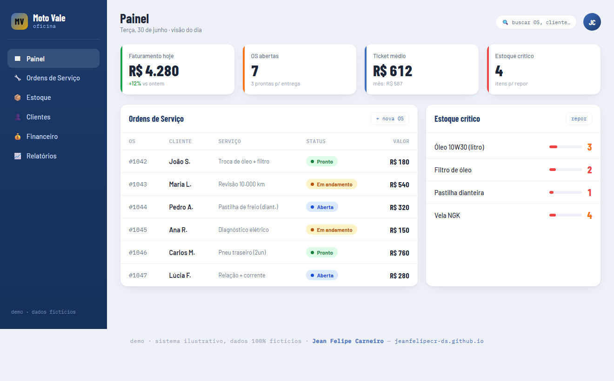

# Sistema de Gestão para Pequenos Negócios — Mockup

Tela operacional de um sistema de gestão (oficina): **ordens de serviço, estoque crítico e KPIs do
dia**. É a tese "**construo o sistema que GERA o dado**" — muitos pequenos negócios rodam no caderno
e na planilha; o sistema vira a fonte, e a análise de dados entra em cima. **Mockup ilustrativo,
dados 100% fictícios.**

🔗 **Demo ao vivo:** https://jeanfelipecr-ds.github.io/management-system-demo/

- **Painel do dia**: faturamento, OS abertas, ticket médio, estoque crítico.
- **Ordens de serviço** com status (aberta / em andamento / pronto) e **estoque** com alerta de reposição.
- Mockup estático single-file. O produto real é um **SaaS multi-tenant** (React · TypeScript · Supabase · Postgres **RLS**) — código de cliente, privado.

Parte do portfólio de **Jean Felipe Carneiro** — Analista de Dados · Analytics Engineering · Fundação dos Dados · [jeanfelipecr-ds.github.io](https://jeanfelipecr-ds.github.io)

🇬🇧 <b>English</b>

 

# Small-Business Management System — Mockup

Operational screen of a management system (auto-repair shop): **work orders, low-stock alerts and
daily KPIs**. It's the "**I build the system that GENERATES the data**" thesis — many small
businesses run on notebooks and spreadsheets; the system becomes the source, and analytics builds
on top. **Illustrative mockup, 100% synthetic data.**

🔗 **Live demo:** https://jeanfelipecr-ds.github.io/management-system-demo/

- **Daily panel**: revenue, open work orders, average ticket, critical stock.
- **Work orders** with status (open / in progress / done) and **inventory** with restock alerts.
- Static single-file mockup. The real product is a **multi-tenant SaaS** (React · TypeScript · Supabase · Postgres **RLS**) — private client code.

Part of the portfolio of **Jean Felipe Carneiro** — Data Analyst · Analytics Engineering · [jeanfelipecr-ds.github.io](https://jeanfelipecr-ds.github.io)

